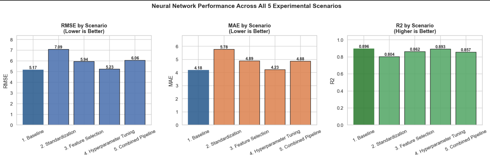
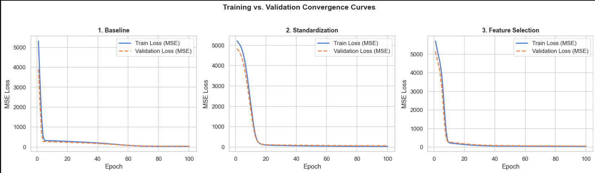
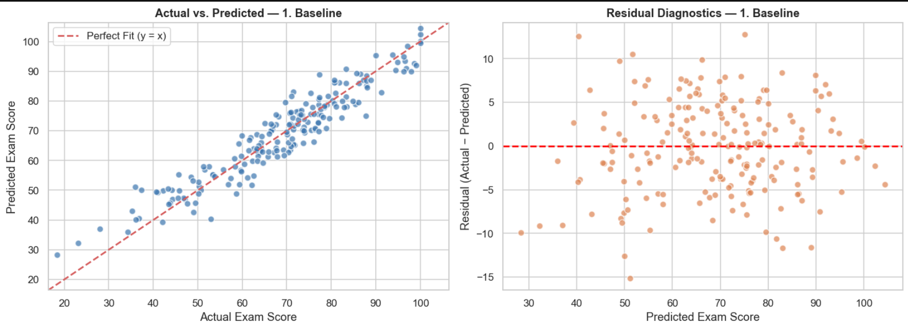

# Student Exam Score Prediction — Backpropagation Neural Network Regression

An end-to-end machine learning regression project analyzing how daily student habits—such as study time, sleep, screen time, attendance, exercise, and mental health—affect academic exam scores. Five progressive neural network scenarios are benchmarked on a shared train–test split with leakage-free preprocessing and cross-validated hyperparameter tuning.

## Tech Stack
* **Deep Learning & Tuning:** Python, TensorFlow / Keras, SciKeras, Scikit-learn (`GridSearchCV`, `Pipeline`)
* **Data Processing & Visualization:** NumPy, Pandas, Matplotlib, Seaborn

---

## Dataset Overview
* **File:** `student_habits_performance.csv` (1,000 student records)
* **Target Variable:** `exam_score` (continuous, range `18.4 – 100.0`, mean `69.60`, median `70.50`, std `16.89`)
* **Input Features (14 total after dropping `student_id`):**
  * **8 Numerical:** `age`, `study_hours_per_day`, `social_media_hours`, `netflix_hours`, `attendance_percentage`, `sleep_hours`, `exercise_frequency`, `mental_health_rating`
  * **6 Categorical:** `gender`, `part_time_job`, `diet_quality`, `parental_education_level`, `internet_quality`, `extracurricular_participation`
* **Data Cleaning:** Missing entries in `parental_education_level` are imputed as an explicit `'None'` category rather than dropped, preserving all 1,000 records.

---

## Experimental Design
All five scenarios are evaluated on the **same 80/20 train–test split** (`RANDOM_STATE = 42`) with locked random seeds and strict leakage prevention:

| Scenario | Description | Features | Scaling | Tuning |
| :--- | :--- | :--- | :--- | :--- |
| **1. Baseline** | Default MLP (`16 → 8 → 1`, ReLU, Adam `lr=0.001`) | All encoded | None | None |
| **2. Standardization** | `StandardScaler` fit strictly on training data | All encoded | `StandardScaler` | None |
| **3. Feature Selection** | Top 5 predictors ranked using training-split correlation | Top 5 | None | None |
| **4. Hyperparameter Tuning** | 3-fold `GridSearchCV` over layer sizes, `lr`, and `batch_size` | All encoded | None | `GridSearchCV` |
| **5. Combined Pipeline** | End-to-end `Pipeline` (Top 5 + per-fold scaling + tuning) | Top 5 | `StandardScaler` (per fold) | `GridSearchCV` |

---

## Results Summary

| Scenario | RMSE ↓ | MAE ↓ | R² Score ↑ |
| :--- | :---: | :---: | :---: |
| 1. Baseline | 5.1677 | 4.1844 | 0.8959 |
| 2. Standardization | 7.0936	 | 5.7799 | 0.8038 |
| 3. Feature Selection | 5.9393 | 4.8914 | 0.8624 |
| 4. Hyperparameter Tuning | 5.2266 | 4.2309 | 0.8935 |
| 5. Combined Pipeline | 6.0589 | 4.8797 | 0.8568 |
| **Average (All 5 Scenarios)** | **5.8972** | **4.7933** | **0.8625** |

---

## Key EDA & Modeling Insights
* **Strongest Predictors:** `study_hours_per_day` ($r \approx 0.83$) and `mental_health_rating` ($r \approx 0.32$) show the strongest positive correlation with exam scores, while `netflix_hours` ($r \approx -0.17$) and `social_media_hours` ($r \approx -0.17$) correlate negatively.
* **Leakage Prevention:** Standard scaling and correlation-based feature ranking are computed exclusively on the training set (and inside each CV fold via `sklearn.pipeline.Pipeline` in Scenario 5).
* **Feature Breadth vs. Pruning:** Retaining secondary predictors (such as `sleep_hours` and `attendance_percentage`) preserves additional signal that aggressive top-5 pruning can drop.

### Diagnostic Visuals




---

## Project Structure
```text
.
├── images/                                # Exported EDA & diagnostic charts
├── student_exam_score_nn_portfolio.ipynb  # Main end-to-end analysis & modeling notebook
├── student_habits_performance.csv         # Dataset (1,000 records)
├── requirements.txt                       # Python dependencies
└── README.md
```

---

## Getting Started

1. **Clone the repository**
   ```bash
   git clone https://github.com/andreasreynard/Machine-Learning-Portfolio.git
   cd Machine-Learning-Portfolio
   ```
2. **Create a virtual environment and install dependencies**
   ```bash
   python -m venv venv
   venv\Scripts\activate        # Windows
   # source venv/bin/activate   # macOS / Linux
   pip install -r requirements.txt
   ```
3. **Run the notebook**
   ```bash
   jupyter notebook student_exam_score_nn_portfolio.ipynb
   ```
   Select **Kernel → Restart & Run All** to reproduce all tables and charts.

---

## Limitations & Future Work
* **Small Tabular Sample Size:** With 1,000 rows, neural networks are sensitive to initialization and epoch budgets; benchmarking against **Ridge Regression**, **Random Forest**, and **XGBoost / LightGBM** is a natural next step.
* **Score Ceiling Effect:** Since `exam_score` is capped at `100.0`, unconstrained linear output neurons can slightly overshoot `100` for top-scoring students.
* **Regularization:** Adding `EarlyStopping(restore_best_weights=True)` and testing `Dropout` or L2 regularization could further stabilize validation loss.